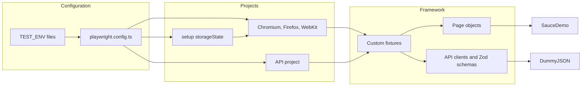
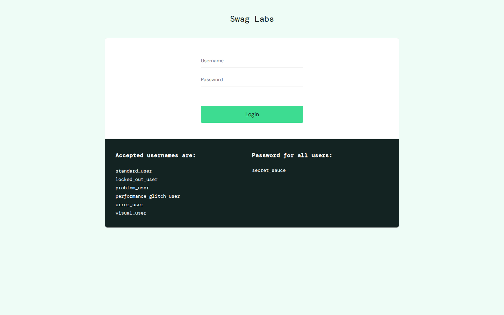
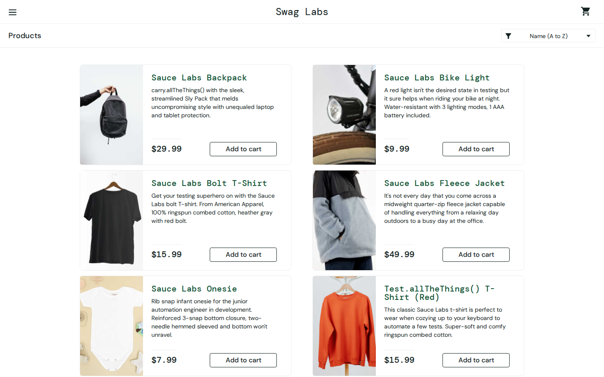
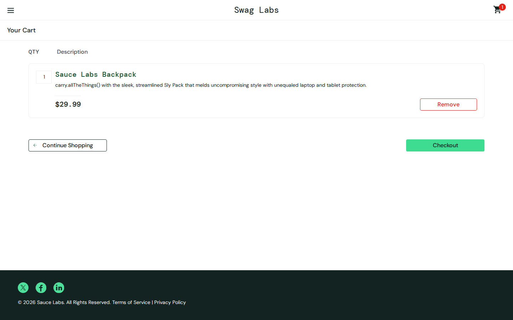
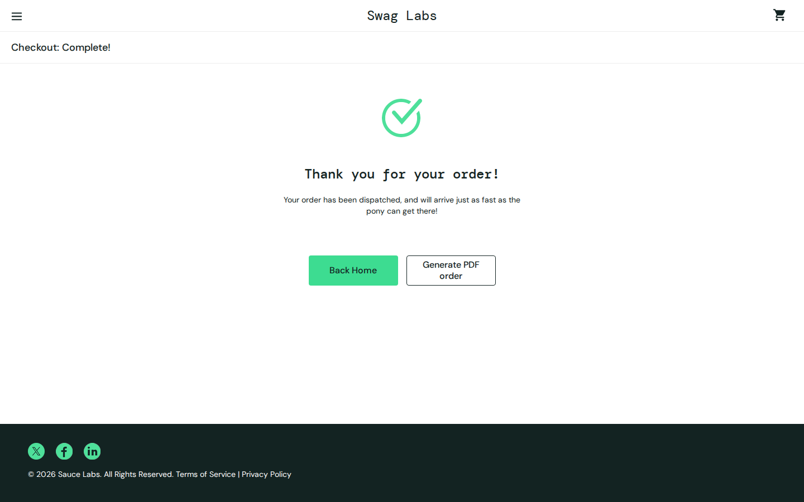
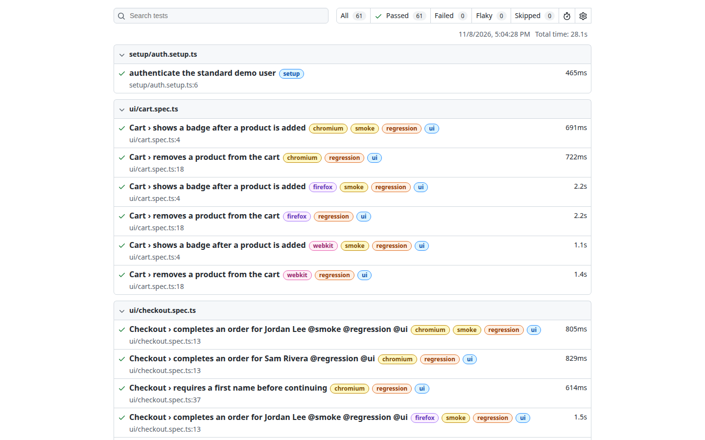
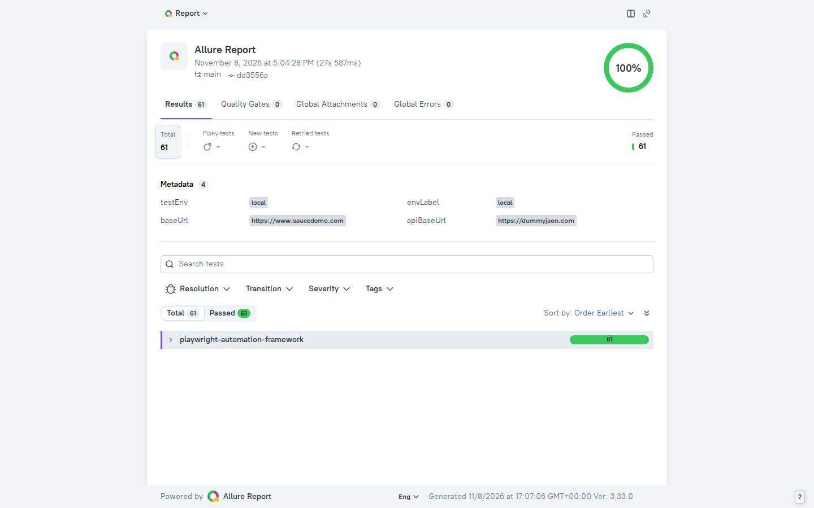

# Playwright Automation Framework

Cross-browser UI and API automation framework built with Playwright and TypeScript. It is a portfolio project by Hassan Mehmood, a Senior SQA Automation Engineer, and it targets public demo applications only.

[](https://github.com/hassanmehmoodd/playwright-automation-framework/actions/workflows/playwright.yml)
[](https://playwright.dev/)
[](https://www.typescriptlang.org/)
[](https://nodejs.org/)
[](LICENSE)

The UI suite drives [SauceDemo](https://www.saucedemo.com/). The API suite calls [DummyJSON](https://dummyjson.com/). Both sites publish their demo behavior and credentials. Nothing in this repository needs a secret.

## Architecture

Configuration selects an environment, then Playwright fans the same fixtures out to a setup project, three browser projects, and a dedicated API project. Page objects talk to SauceDemo. API clients talk to DummyJSON and validate responses with Zod.



Authenticated UI tests reuse one login captured by the setup project. Login specs opt out with an empty `storageState`, so they still exercise the real sign-in form. Tag filters are applied on the browser and API projects only, which keeps setup running when you select `@smoke` or `@regression`.

## Folder structure

```text
.
├── .github/workflows/playwright.yml   # CI matrix
├── config/environments/               # local.env and ci.env
├── docs/screenshots/                  # Images captured from a real run
├── scripts/capture-docs.mjs           # Regenerates the images above
├── src/
│   ├── api/                           # HTTP clients and Zod schemas
│   ├── config/                        # Env loader and data paths
│   ├── fixtures/                      # Playwright fixture extensions
│   ├── pages/                         # Page objects
│   ├── schemas/                       # Test-data schemas
│   └── utils/                         # CSV/JSON, money, network, logging
├── test-data/                         # JSON and CSV fixtures
├── tests/
│   ├── api/                           # DummyJSON tests
│   ├── setup/auth.setup.ts            # storageState login
│   └── ui/                            # SauceDemo tests
├── playwright.config.ts
├── .env.example
└── package.json
```

## Features

| Capability                        | Where it lives                                                  |
| --------------------------------- | --------------------------------------------------------------- |
| Page Object Model                 | `src/pages/`                                                    |
| Custom fixtures                   | `src/fixtures/index.ts`                                         |
| UI automation                     | `tests/ui/`                                                     |
| API automation                    | `tests/api/`, `src/api/clients/`                                |
| Chromium, Firefox, and WebKit     | `playwright.config.ts` projects                                 |
| Authentication via `storageState` | `tests/setup/auth.setup.ts`                                     |
| Environment configuration         | `src/config/env.ts`, `config/environments/`, `.env.example`     |
| Data-driven JSON and CSV tests    | `test-data/`, `src/utils/data-loader.ts`                        |
| Helpers                           | `src/utils/`                                                    |
| Screenshot and video on failure   | `playwright.config.ts` (`only-on-failure`, `retain-on-failure`) |
| Trace on first retry              | `playwright.config.ts` (`trace: 'on-first-retry'`)              |
| Parallel execution                | `fullyParallel: true`                                           |
| Retries: 2 on CI, 0 locally       | `playwright.config.ts`                                          |
| HTML report                       | `playwright-report/`                                            |
| Allure report                     | `allure-playwright`, `allure-results/`                          |
| Tags and npm scripts              | `@smoke`, `@regression`, `@ui`, `@api`, `@mock`                 |
| Network interception              | `tests/ui/network.spec.ts`                                      |
| API schema validation             | Zod schemas in `src/api/schemas/`                               |
| GitHub Actions                    | `.github/workflows/playwright.yml`                              |

## Installation

Requires Node.js 22 (see `.nvmrc`). Node.js 20 or newer is accepted.

```bash
git clone https://github.com/hassanmehmoodd/playwright-automation-framework.git
cd playwright-automation-framework
npm ci
npx playwright install --with-deps
npm test
```

A gitignored `.env` file is optional. Copy `.env.example` when you want local overrides. Process environment wins, then `.env`, then `config/environments/<TEST_ENV>.env`, then the built-in public defaults.

```bash
npm run test:local   # TEST_ENV=local
npm run test:ci      # TEST_ENV=ci
```

`local` and `ci` both point at the same public demo apps. The split is there so a real staging host can be dropped in without changing tests.

## Execution

| Command                   | What it runs                                         |
| ------------------------- | ---------------------------------------------------- |
| `npm test`                | Setup, UI on all three browsers, and the API project |
| `npm run test:smoke`      | Tests tagged `@smoke`                                |
| `npm run test:regression` | Tests tagged `@regression`                           |
| `npm run test:ui`         | Tests tagged `@ui`                                   |
| `npm run test:api`        | API project, tests tagged `@api`                     |
| `npm run test:mock`       | Network-interception tests                           |
| `npm run test:chromium`   | UI tests in Chromium, plus setup                     |
| `npm run test:firefox`    | UI tests in Firefox, plus setup                      |
| `npm run test:webkit`     | UI tests in WebKit, plus setup                       |
| `npm run test:headed`     | Chromium in headed mode                              |
| `npm run lint`            | ESLint                                               |
| `npm run typecheck`       | `tsc --noEmit`                                       |
| `npm run format:check`    | Prettier                                             |

Use the npm scripts for tags. They set `TEST_GREP`, and the config applies that filter only to the browser and API projects. A raw `npx playwright test --grep @smoke` also filters the setup project, so the saved login file is never created.

Static tests declare tags with Playwright's `tag` option. The checkout customers in `test-data/checkout-customers.json` carry their tags in the row, and the test title includes them so `@smoke` selects only the first customer.

## Reporting

A normal run writes:

- `playwright-report/` for the HTML report. Open it with `npm run report`.
- `allure-results/` for Allure. Build the HTML report with `npm run allure:generate`, then open it with `npm run allure:open`.
- `test-results/` when something fails: a screenshot, a video, and a trace if the failure happened on a retry.

CI keeps retries at 2 and `trace: 'on-first-retry'`, so a flake still produces a trace without recording one for every passing test. Local runs do not retry.

```bash
npm run allure:generate
npm run allure:open
```

## Continuous integration

[`.github/workflows/playwright.yml`](.github/workflows/playwright.yml) runs on pushes and pull requests to `main`, and on `workflow_dispatch`. Path filters skip docs-only changes so free GitHub minutes are not spent regenerating screenshots. Concurrency cancels an in-progress run on the same ref.

The job matrix is:

| Job             | Scope                                | Browsers installed               |
| --------------- | ------------------------------------ | -------------------------------- |
| `chromium`      | Full UI project plus the API project | Chromium                         |
| `firefox-smoke` | `@smoke` UI tests                    | Chromium (for setup) and Firefox |
| `webkit-smoke`  | `@smoke` UI tests                    | Chromium (for setup) and WebKit  |

Each job uses `npm ci`, caches npm and the Playwright browser binaries, installs OS dependencies with `npx playwright install --with-deps`, and always uploads `playwright-report/`, `test-results/`, and `allure-results/` as artifacts.

## Screenshots

These images were captured from SauceDemo and from the reports of a local run on 8 November 2026. That run executed 61 tests: 17 UI tests on Chromium, 17 on Firefox, 17 on WebKit, 9 API tests, and 1 authentication setup. All 61 passed. Regenerate the gallery with `npm run docs:capture` while the report servers are running if you want fresh report images.













## Author

**Hassan Mehmood**, Senior SQA Automation Engineer

- GitHub: [https://github.com/hassanmehmoodd](https://github.com/hassanmehmoodd)
- LinkedIn: [https://www.linkedin.com/in/hassan-mehmood-hm2/](https://www.linkedin.com/in/hassan-mehmood-hm2/)

Licensed under the [MIT License](LICENSE). Copyright 2026 Hassan Mehmood.
